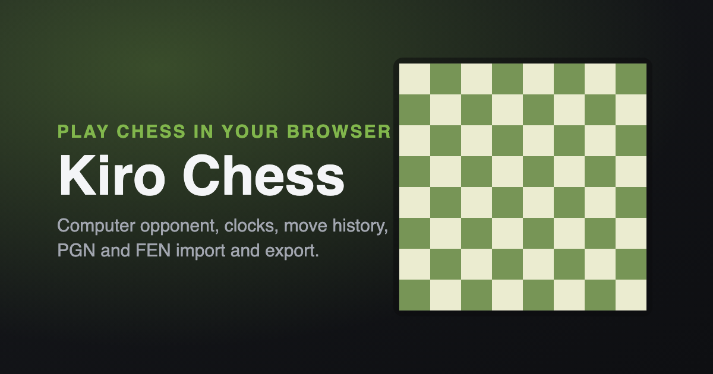

# onlinechess

A chess learning platform that runs in the browser with no dependencies and no build step.
Built by [onlinechess](https://onlinechess.me), an education technology company in Sikar,
Rajasthan, India.

**Live:** https://onlinechess.me

## Features

**Rules** — full legal move generation including castling, en passant, and promotion, with check, checkmate, stalemate, threefold repetition, the fifty-move rule, and insufficient-material draws.

**Opponents** — play the computer at four strengths, or pass and play locally on one device.

**Clocks** — bullet, blitz, and rapid presets with increment support, plus an unlimited mode.

**Board** — drag and drop, tap, or use the keyboard to move, with legal-move hints, last-move and check highlights, coordinates, and board flip. Pawn promotion supports named, keyboard-focusable choices.

**Review** — move history in algebraic notation, clickable to jump to any position, with arrow-key navigation and takeback. Captured pieces and the evaluation bar follow the position being reviewed.

**Analysis** — live evaluation bar, captured pieces, and material advantage.

**Import and export** — copy or load PGN and FEN, or download a game as a `.pgn` file. PGN imports support custom starting positions, game results, comments, annotations, and nested variations. Invalid imports preserve the current game.

**Resume** — games and settings are saved locally in the browser. A restored game's clock stays stopped until the next move.

**Presentation** — four board themes, synthesized sound effects, and a responsive layout. Respects `prefers-reduced-motion`, includes a skip link and visible focus states.

Not included: online multiplayer, accounts, ratings, and puzzles. Those need a backend and a database.

## Running it

Open `index.html` directly in a browser. Nothing to install.

To run the production server instead:

```bash
npm start          # serves on http://localhost:3000, or $PORT
```

Requires Node.js 24 or newer. There are no runtime dependencies.

## Keyboard controls

Focus the board, then use the arrow keys to choose a square. Press Enter or Space
to select a piece and again to move it; Escape cancels the selection. Arrow keys
follow the board's orientation. When promoting a pawn, use the arrow keys or Tab
to choose a piece and Enter to confirm, or press Q, R, B, or N directly. Escape
cancels promotion and returns focus to the board.

Outside the board, Left and Right review move history, F flips the board, and N
opens a new game. These shortcuts pause while the promotion picker is open.

## Importing and saving games

Paste a complete, six-field FEN position or a single game's PGN into the import
box, then choose the matching Load button. PGN `SetUp` and `FEN` headers preserve
custom starting positions, including games that start with Black to move. A
declared PGN result keeps a finished game closed to further moves.

Copy PGN and Download PGN export the whole game, including its starting position
and result. Copy FEN exports the position currently shown on the board, including
an earlier position selected during review.

## Site structure

| Route | Page |
| --- | --- |
| `/` | the playable board |
| `/about` | company and product overview |
| `/contact` | contact details |
| `/privacy` | privacy policy |
| `/terms` | terms of service |

`robots.txt` and `sitemap.xml` are generated by the server so they always use the canonical
host. Requests arriving over HTTP, or on any other hostname, are redirected to
`https://onlinechess.me`. Set `CANONICAL_HOST` to change that.

### Changing the company name

The name appears in each page's `<title>`, header, and footer, and in `og.png`. Search for
`onlinechess` across `*.html` to update all of it.

## Project layout

```
index.html        markup and dialogs
about.html        company overview
contact.html      contact details
privacy.html      privacy policy
terms.html        terms of service
css/styles.css    design tokens, layout, and motion
js/engine.js      rules engine: move generation, SAN, FEN, PGN
js/ai.js          negamax search with alpha-beta and quiescence
js/worker.js      computer search off the main thread when workers are available
js/ui.js          board rendering and pointer input
js/game.js        controller: clocks, history, actions
js/main.js        settings, dialogs, keyboard shortcuts
js/pieces.js      piece glyphs
js/sounds.js      Web Audio sound effects
server.js         static server used in production
```

The engine indexes the board 0–63 with index 0 at a8. Pieces are positioned with the
CSS `translate` property so movement stays on the compositor.

## Correctness

Move generation is verified with [perft](https://www.chessprogramming.org/Perft_Results) against
the standard test positions:

| Position | Depth | Nodes |
| --- | --- | --- |
| Initial | 4 | 197,281 |
| Kiwipete | 3 | 97,862 |
| Position 3 | 4 | 43,238 |
| Position 4 | 3 | 9,467 |
| Position 5 | 3 | 62,379 |

All match the published counts. To check yourself:

```bash
node -e 'require("./js/engine.js"); console.log(new Chess().perft(4))'   # 197281
```

Run the regression suite and JavaScript syntax checks with:

```bash
npm test
npm run check
```

The suite covers rules, computer play, rendering, keyboard controls, game
restoration, imports and exports, and server behaviour.

## Deploying

The app is a Node process that serves static files, so any Node host works. For Heroku:

```bash
heroku create your-app-name
git push heroku main
```

Heroku detects Node from `package.json` and runs `npm start`. Point a custom domain at the
app and set `CANONICAL_HOST` if it differs from the default.

## Credits

The visual design pass follows the `redesign-existing-projects` skill from
[Open Design](https://github.com/nexu-io/open-design) (MIT licensed) — swapping generic
defaults for deliberate typography, a single accent colour, tinted shadows, and
compositor-driven motion. Content was rephrased for compliance with licensing restrictions.

## License

MIT — see [LICENSE](LICENSE).
